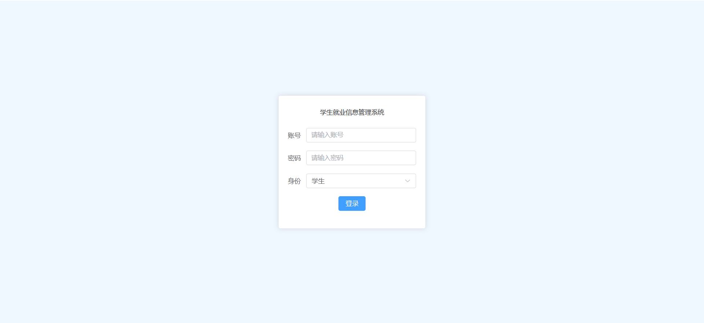
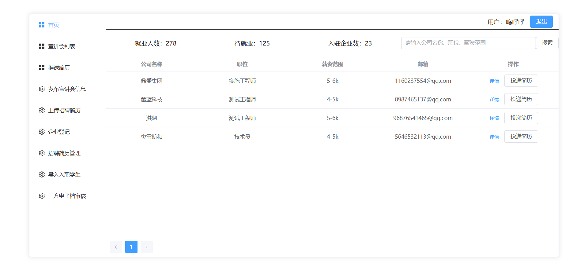
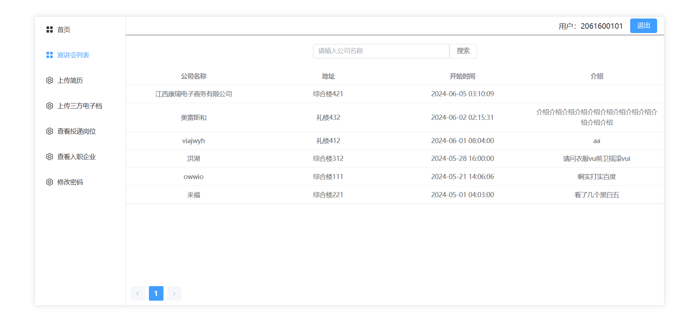
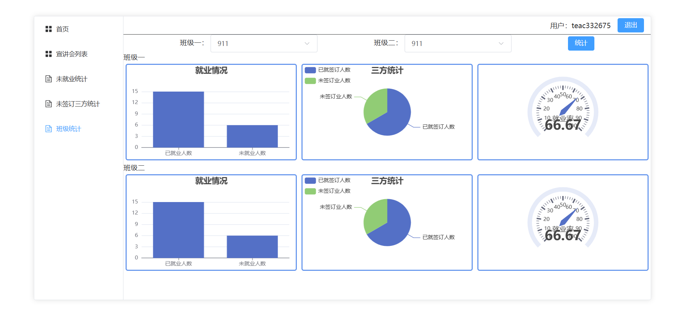
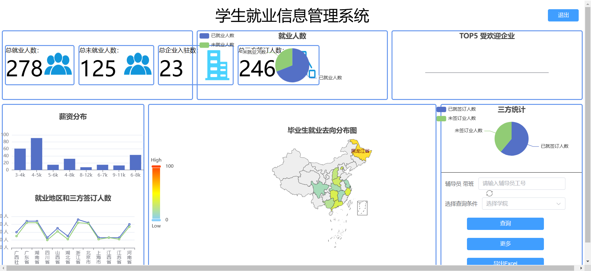

## 项目简介

>项目来源于：
前端：[https://gitee.com/xieyeming/bs-ui](https://gitee.com/xieyeming/bs-ui)
后端：[hhttps://gitee.com/xieyeming/bi-design](https://gitee.com/xieyeming/bi-design)

**项目介绍**

这是一套完整的学生就业信息管理系统，采用前后端分离架构设计，包含基于Vue 3的现代化前端界面和基于Spring Boot的高性能后端服务。系统功能涵盖学生信息管理、简历管理、宣讲会管理、就业统计分析等核心业务流程，适用于高校就业指导中心进行学生就业情况的全面管理与数据分析。

**项目特点：**
- 基于Vue 3 + TypeScript + Vite 5的现代化前端架构
- 支持多角色权限控制系统（管理员、教师、学生等4种角色）
- 集成ECharts实现就业数据可视化统计与分析
- 使用Element Plus提供丰富的企业级UI组件
- 模块化设计，便于功能扩展与维护
- 完整的业务流程覆盖，从学生信息管理到就业统计全流程支持

**难度等级：困难**

## 技术栈

### 前端技术栈

- **核心框架** ：Vue.js 3.4.21（构建用户界面的渐进式JavaScript框架）
- **编程语言** ：TypeScript 5.4.0（提供类型安全的JavaScript超集）
- **构建工具** ：Vite 5.1.6（下一代前端构建工具，提供极速开发体验）
- **UI组件库** ：Element Plus 2.6.3（提供丰富的企业级UI组件）
- **数据可视化** ：ECharts 5.5.0 + vue-echarts 6.6.9（实现各类数据报表与图表展示）
- **HTTP通信** ：Axios 1.6.8（处理与后端API的交互）
- **富文本编辑** ：TinyMCE 7.0.0 + @tinymce/tinymce-vue 5.1.1（支持内容管理功能）
- **路由管理** ：Vue-Router 4.3.0（管理页面路由）
- **文档转换** ：Mammoth 1.7.1（支持文档格式转换）

### 后端技术栈

**核心框架**

- Spring Boot 3.1.0（简化Spring应用开发的微框架）
- MyBatis-Plus 3.5.4（ORM框架，简化数据库操作，提供强大的CRUD能力）
- JWT (java-jwt 4.4.0)（实现无状态的用户认证机制）

**数据层**

- 数据库：MySQL 8.1.0（关系型数据库，存储业务数据）
- 缓存：Redis（内存数据库，提高系统性能）
- 连接池：Spring Boot内置连接池配置

**开发环境**

- 开发语言：Java 17+
- 构建工具：Maven
- 版本控制：Git

**工具库**

- Hutool-all 5.8.16（Java工具集，提高开发效率）
- FastJson（高性能JSON处理库）
- Apache POI 5.2.5（处理Excel文件，支持数据导入导出）
- Lombok（通过注解简化JavaBean编写）
- SpringDoc OpenAPI（自动生成API文档）

**其他组件**

- Spring Boot Starter Mail（邮件发送功能）
- Spring Boot Starter Validation（参数校验）

## 本地运行

### 后端运行

#### 前提条件

- JDK 17或更高版本
- Maven 3.0或更高版本
- MySQL数据库（推荐8.0+）
- Redis服务器

#### 启动步骤

1. 导入项目：
  - IntelliJ IDEA：选择 File -> Open ，选择项目根目录
  - Eclipse：选择 File -> Import -> Existing Maven Projects ，选择项目根目录

2. 数据库配置：

  - 在MySQL中创建数据库`students_system`，执行src\main\java\com\xie\SQL\students_system.sql
  - 在 `application.yml` 中修改数据库连接信息（用户名、密码）

3. Redis配置：

  - 确保Redis服务正常运行
  - 在 `application.yml` 中修改Redis连接信息（主机、端口、密码）


4. 找到主入口类 `com.xie.App.java`

5. 右键点击该类，选择 Run 'App' 或 Debug 'App'


### 前端运行

#### 前提条件

- Node.js 16.0或更高版本
- npm 7.0或更高版本

#### 启动步骤


1. 安装依赖

```sh
npm install
```

2. 启动开发服务器

```sh
npm run dev
```


#### 访问路径

开发服务器启动成功后，您可以通过以下地址访问系统：

- **系统地址** ：http://localhost:5173/

- **账号信息** ：系统支持4种角色登录，账号密码在数据库中的admin、student、teacher等表中可以找到，密码均为123456。

## 项目截图





## 声明
- 该项目收集于gitee，本人只是代为说明使用技术、注意点及启动方式，帮助大家进行学习交流。
- **若通过gitee地址无法下载该项目或无法正常运行，可私信我协助。**

欢迎关注我的公众号“**张有路**”，原创技术文章第一时间推送。


