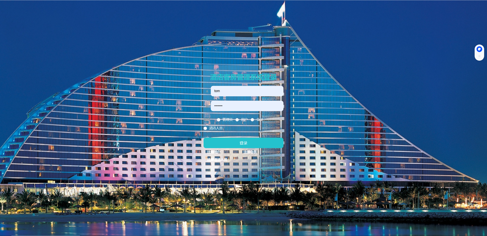
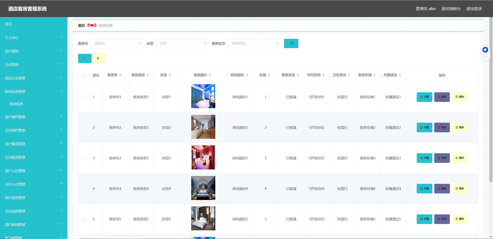
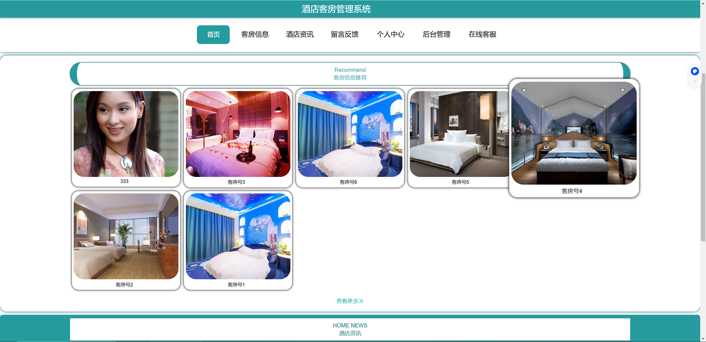

## 项目简介

>项目来源于：[https://gitee.com/kasxbls/springboot094](https://gitee.com/kasxbls/springboot094)

**项目介绍**

这是一套基于Spring Boot框架开发的企业级酒店管理系统，采用前后端分离架构设计，包含完整的后端API服务和现代化的前端界面。系统功能涵盖客房管理、会员管理、入住登记、订单处理、报表统计等酒店日常运营的核心业务流程，适用于中小型酒店、民宿及连锁酒店的信息化管理需求。

**项目特点：**
- 采用前后端分离架构，提供管理后台与用户前台双界面
- 集成Shiro安全框架，实现细粒度权限控制
- 内置数据统计与可视化功能，支持经营数据分析
- 模块化设计，便于功能扩展与维护
- 完整的业务流程覆盖，从客户预订到离店结算全流程管理

**难度等级：困难**

## 技术栈

### 前端技术栈

项目采用现代化前端技术栈，包含两个独立的前端模块：

**管理后台（Admin）**
- **核心框架**：Vue.js 2.6.10（构建用户界面的渐进式JavaScript框架）
- **UI组件库**：Element UI 2.13.0（提供丰富的企业级UI组件）
- **数据可视化**：ECharts 4.6.0（实现各类数据报表与图表展示）
- **HTTP通信**：Axios 0.19.2（处理与后端API的交互）
- **富文本编辑**：Vue-Quill-Editor 3.0.6（支持内容管理功能）
- **地图集成**：Vue-Amap 0.5.10（实现地理位置展示与选择）
- **数据导出**：Vue-JSON-Excel 0.3.0（支持数据报表导出为Excel）
- **路由管理**：Vue-Router 3.1.5（管理后台页面路由）
- **状态管理**：Vuex（管理复杂组件间通信与状态共享）

**用户前台（Front）**
- **UI框架**：Element UI + LayUI混合架构（提供友好的用户界面）
- **架构模式**：模块化设计（提高代码复用性与维护性）
- **静态资源**：CSS、JavaScript、图片等资源组织合理，支持浏览器缓存优化

### 后端技术栈

**核心框架**
- Spring Boot 2.2.2.RELEASE（简化Spring应用开发的微框架）
- MyBatis + MyBatis-Plus 2.3（ORM框架，简化数据库操作）
- Apache Shiro 1.3.2（安全框架，提供认证、授权功能）

**数据层**
- 数据库：MySQL（默认配置），支持SQL Server无缝切换
- 连接池：Spring Boot内置连接池配置

**开发环境**
- 开发语言：Java 1.8
- 构建工具：Maven
- 版本控制：Git

**工具库**
- Hutool-all 4.0.12（Java工具集，提高开发效率）
- FastJson 1.2.8（高性能JSON处理库）
- Apache Commons Lang3（通用工具类库）

## 本地运行

### 前提条件
- JDK 1.8或更高版本
- Maven 3.0或更高版本
- MySQL数据库（推荐5.7+）

### 启动步骤
1. 下载zip直接解压或安装git后执行克隆命令 

2. 导入项目：
    - IntelliJ IDEA：选择 File -> Open ，选择项目根目录
    - Eclipse：选择 File -> Import -> Existing Maven Projects ，选择项目根目录
3. 数据库配置：

- 导入项目中的sql文件
- 在 application.yml 中修改数据库连接信息（用户名、密码）

4. 找到主入口类 com.SpringbootSchemaApplication.java

5. 右键点击该类，选择 Run 'SpringbootSchemaApplication' 或 Debug 'SpringbootSchemaApplication'

### 访问路径
后端服务启动成功后，您可以通过以下地址访问系统：

- **管理后台**：[http://localhost:8080/springboot6alf1/admin/dist/index.html](http://localhost:8080/springboot6alf1/admin/dist/index.html)
  - 管理员账号：abo
  - 密码：abo

- **用户前台**：[http://localhost:8080/springboot6alf1/front/index.html](http://localhost:8080/springboot6alf1/front/index.html)

## 项目截图

## 声明
- 该项目收集于gitee，本人只是代为说明使用技术、注意点及启动方式，帮助大家进行学习交流。
- **若通过gitee地址无法下载该项目或无法正常运行，可私信我协助。**

欢迎关注我的公众号“**张有路**”，原创技术文章第一时间推送。

