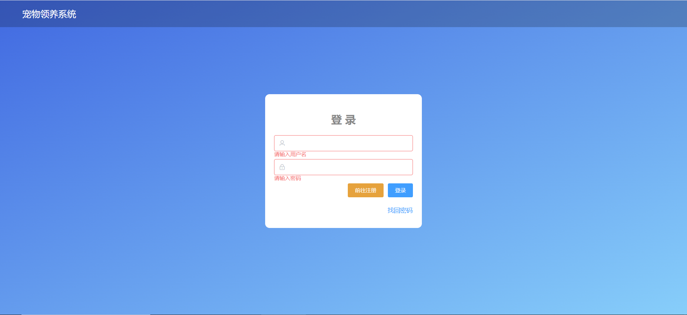
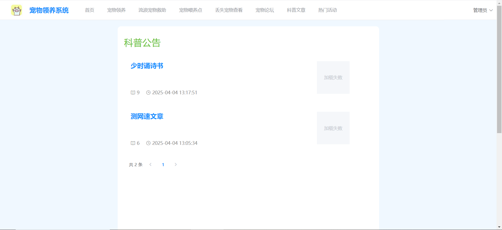
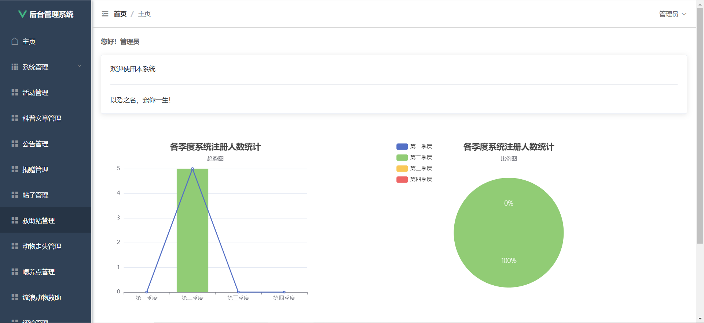

## 项目简介

>项目来源于：
前端：[https://gitee.com/proitzyq/pet-web](https://gitee.com/proitzyq/pet-web)
后端：[https://gitee.com/proitzyq/pet](https://gitee.com/proitzyq/pet)

**项目介绍**

这是一套完整的流浪动物管理系统，采用前后端分离架构设计，包含基于Vue的现代化前端界面和基于Spring Boot的高性能后端服务。系统功能涵盖流浪动物信息管理、领养申请管理、救助活动管理、宠物知识分享、用户中心等核心业务流程，致力于为宠物爱好者和动物保护组织提供一个全方位的交流与管理平台。

**项目特点：**

- 基于Vue.js + Spring Boot的前后端分离架构
- 支持多角色权限控制系统（管理员、普通用户等）
- 集成Excel导入导出功能，方便数据批量处理
- 丰富的宠物相关功能模块，包括领养、救助、活动管理等
- 模块化设计，便于功能扩展与维护
- 响应式布局，适配不同设备访问
- 完整的流浪动物救助流程覆盖，从动物信息管理到领养申请全流程支持

**难度等级：困难**

## 技术栈

### 前端技术栈

- **核心框架**：Vue.js 2.6.11（构建用户界面的渐进式JavaScript框架）
- **构建工具**：Vue CLI 4.5.x（Vue.js 开发的标准工具）
- **UI组件库**：Element UI 2.15.6（提供丰富的企业级UI组件）
- **数据可视化**：ECharts 5.3.0（实现各类数据图表展示）
- **HTTP通信**：Axios 0.25.0（处理与后端API的交互）
- **富文本编辑**：Mavon Editor 2.10.4（支持Markdown格式的内容编辑）
- **路由管理**：Vue Router 3.2.0（管理页面路由）
- **状态管理**：Vuex 3.6.2（集中式状态管理）
- **轮播组件**：Swiper 5.4.5 + vue-awesome-swiper 3.1.3（实现图片轮播效果）

### 后端技术栈

**核心框架**

- Spring Boot 2.5.9（简化Spring应用开发的微框架）
- MyBatis-Plus 3.5.1（ORM框架，简化数据库操作，提供强大的CRUD能力）
- JWT (java-jwt 3.10.3)（实现无状态的用户认证机制）

**数据层**

- 数据库：MySQL 8.0.33（关系型数据库，存储业务数据）
- 连接池：Spring Boot内置连接池配置

**开发环境**

- 开发语言：Java 1.8
- 构建工具：Maven
- 版本控制：Git

**工具库**

- Hutool-all 5.7.20（Java工具集，提高开发效率）
- Apache POI 4.1.2（处理Excel文件，支持数据导入导出）
- Lombok（通过注解简化JavaBean编写）
- Springfox Swagger 3.0.0（自动生成API文档）

## 本地运行

### 后端运行

#### 前提条件

- JDK 1.8或更高版本
- Maven 3.0或更高版本
- MySQL数据库（推荐8.0+）

#### 启动步骤

1. 导入项目：
   - IntelliJ IDEA：选择 File -> Open ，选择项目根目录
   - Eclipse：选择 File -> Import -> Existing Maven Projects ，选择项目根目录

2. 数据库配置：

   - 在MySQL中创建数据库`stray_animal`，执行项目根目录下的`dump-stray_animal-202502242000.sql`文件
   - 在 `application.yml` 中修改数据库连接信息（用户名、密码）

3. 找到主入口类 `com.qingge.springboot.SpringbootApplication.java`

4. 右键点击该类，选择 Run 'SpringbootApplication' 或 Debug 'SpringbootApplication'

### 前端运行

#### 前提条件

- Node.js 12.0或更高版本
- npm 6.0或更高版本

#### 启动步骤

1. 安装依赖

```sh
npm install
```

2. 启动开发服务器

```sh
npm run serve
```

#### 访问路径

开发服务器启动成功后，您可以通过以下地址访问系统：

- **系统地址**：http://localhost:8081/

- **账号信息**：系统支持多角色登录。
  - 管理员账号：admin/admin


## 项目截图



## 声明
- 该项目收集于gitee，本人只是代为说明使用技术、注意点及启动方式，帮助大家进行学习交流。
- **若通过gitee地址无法下载该项目或无法正常运行，可私信我协助。**

欢迎关注我的公众号“**张有路**”，原创技术文章第一时间推送。


